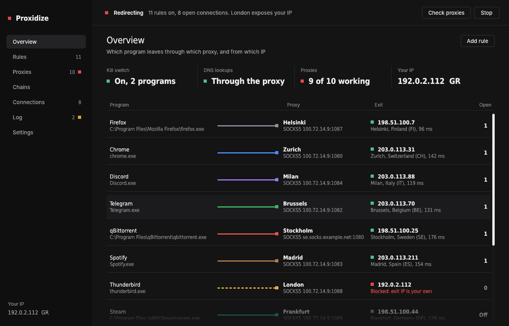

# Proxidize

Per-program proxy redirection for Windows, in one exe. Pick a program, pick a SOCKS5 / SOCKS4 / HTTP proxy or a
chain, and its traffic goes through it, whether or not the program supports proxies.

It ships as a single `proxidize.exe`: no runtime to install, and WinDivert's driver is embedded and unpacked on first
start.



**Status: early.** Everything is ported and tested (the engine runs end to end against a simulated platform in the
test suite), and 0.1 is running on Windows. Expect rough edges; see [PLAN.md](PLAN.md).

## What it does

- **Rules** by program (name or path glob), destination (host globs, `.domain`, IPs, CIDRs, IP ranges), ports and
  transport; first match wins; actions **Proxy / Direct / Block**
- **Proxies:** SOCKS5 (no auth / username+password), SOCKS4 / 4a, HTTP CONNECT (Basic auth); **chains** of any length
- **Remote DNS** through fake-IP DNS: host names go to the proxy, not to your resolver
- **UDP** through SOCKS5 UDP ASSOCIATE; UDP a route can't carry is blocked, never sent directly
- **Leak protection:** strict fail-closed packet handling and a WFP **kill switch** that keeps proxied programs
  offline whenever Proxidize isn't redirecting (stopped, crashed, not started yet after a reboot)
- **Proxy check:** exit IP and country through every proxy, on a schedule; a proxy whose exit IP is your own is
  blocked until it's fixed; tray notifications on changes
- **ProxyCap import** (binary `machine.prs` and XML)
- Start with Windows (elevated, no prompt), passwords encrypted with DPAPI, tray icon as a link light
- **Updates:** checks this repository's releases, and installs a new version with one click after checking its SHA-256

## Using it

Run `proxidize.exe` (it asks for Administrator rights: the packet driver and the kill switch need them). Add a proxy
under **Proxies**, a rule under **Rules**, press **Start**. Closing the window keeps it running in the tray.

| Flag | |
|---|---|
| `--minimized` | start in the tray (used by Start with Windows) |
| `--remove-killswitch` | delete every Proxidize filter from Windows Filtering Platform, e.g. after uninstalling |
| `--demo` | open with sample data, nothing is saved or redirected |
| `--screenshots <folder>` | render every page with the sample data to PNGs |
| `--after-update <pid>`, `--start` | used by the updater: wait for the old instance, then start redirecting if it was |

Config: `%ProgramData%\Proxidize\config.json`. Logs: `%ProgramData%\Proxidize\logs`.

**Coming from another proxifier:** exit it first (ProxyCap runs as a service). Kill switches and firewall rules other
tools leave behind, for example ones that only let a program reach `127.0.0.1` and its proxy, block the program before
Proxidize sees its traffic: remove them.

## Layout

| Crate | What it holds |
|---|---|
| `crates/proxidize-core` | Config, rule engine, packet codec, fragment reassembly, DNS and fake IPs, SOCKS/HTTP clients and chains, relay, proxy check, ProxyCap import |
| `crates/proxidize-win` | The engine: WinDivert (embedded), TCP/UDP redirectors, DNS interception, process lookup, WFP kill switch, DPAPI, autostart |
| `crates/proxidize` | The app: egui window in the patch-panel design, tray |

The redirection logic is written against small traits (packet diversion, process tables, WFP), so the engine's
tests run on any OS. On Linux the app builds as a preview (no redirection) for screenshots and design work.

## Build

Windows 10/11 x64 with the Rust toolchain (`rustup`, MSVC):

```
powershell -File scripts\get-windivert.ps1
cargo build --release
```

`get-windivert.ps1` downloads WinDivert 2.2.2 into `third_party\`; the build embeds it. `cargo test --workspace`
runs the tests. CI builds on every push and publishes a release when the version in `Cargo.toml` has no
release yet (and isn't a `-dev` version).

## Known limitations

- Localhost traffic is never redirected. Programs using DNS-over-HTTPS bypass fake-IP DNS.
- UDP needs a SOCKS5 proxy with UDP ASSOCIATE support.
- The kill switch covers whole-program rules only.
- ICMP (ping, traceroute) is not redirected.
- Some anti-cheat and anti-virus products block WinDivert.

## License

MIT (see `LICENSE`). WinDivert is LGPLv3 / GPLv2 dual-licensed; it is downloaded at build time, not part of the
source, embedded unmodified in the exe, and its license ships in the release zip.
