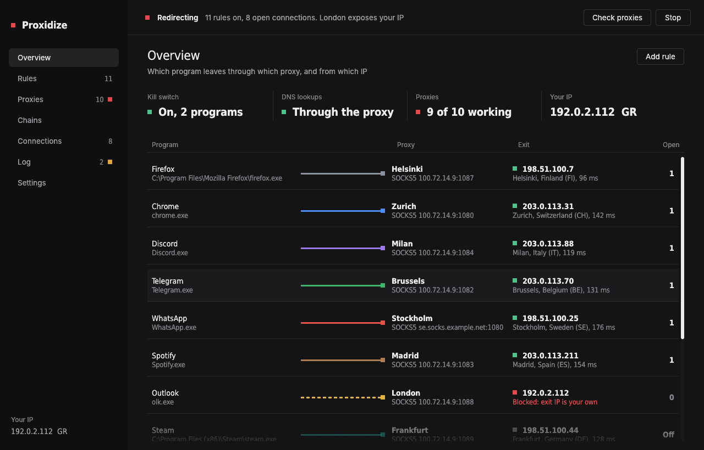
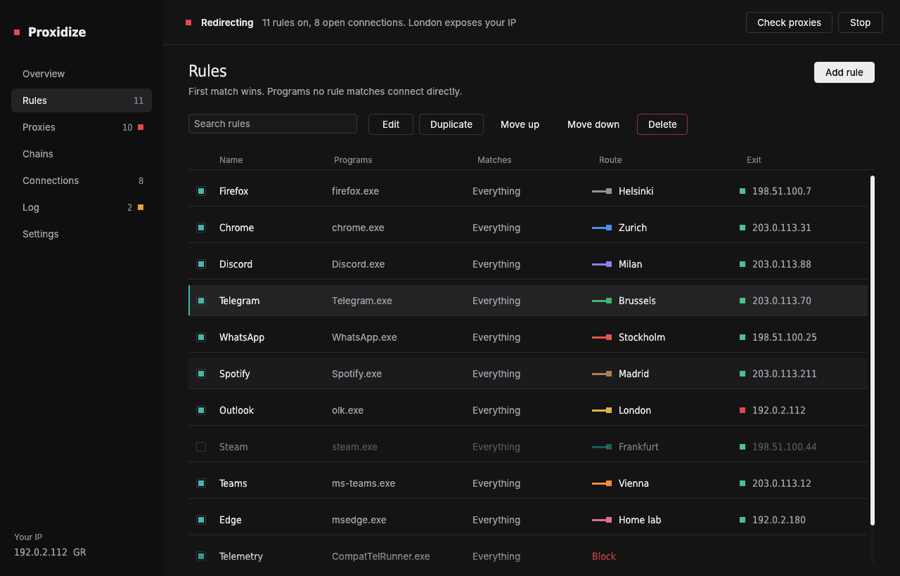
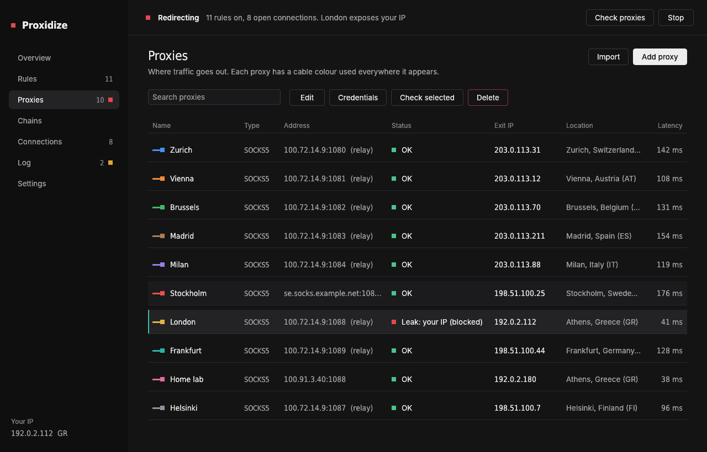
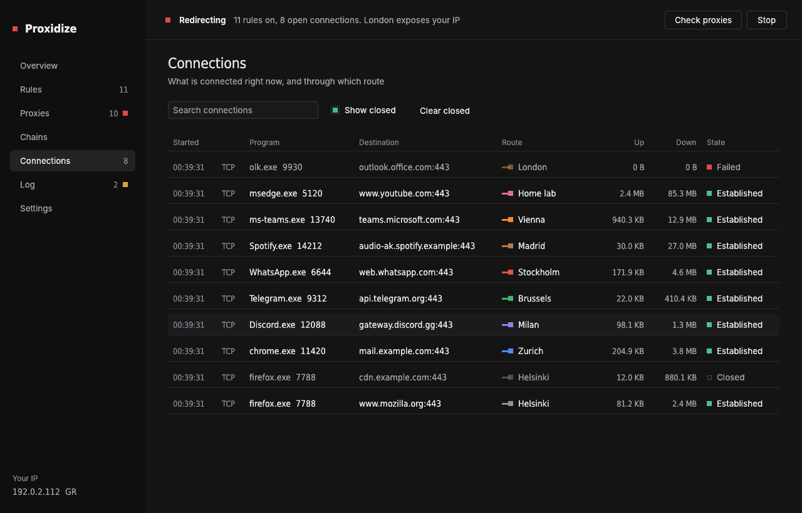

<div align="center">

# Proxidize

**Send any Windows program through a proxy, whether it supports one or not.**

Per-program rules, SOCKS5 / SOCKS4 / HTTP / HTTPS proxies and chains, remote DNS, UDP, and a kill switch that keeps
programs offline instead of leaking. One `proxidize.exe`, nothing to install.

[](https://github.com/p3tr0s/proxidize/releases/latest)
[](https://github.com/p3tr0s/proxidize/actions/workflows/build.yml)
[](https://github.com/p3tr0s/proxidize/releases)
[](LICENSE)


[**Download the latest `proxidize.exe`**](https://github.com/p3tr0s/proxidize/releases/latest) ·
[What's new](CHANGELOG.md) · [Roadmap](PLAN.md)



</div>

## Why Proxidize

- **Works with any program.** Traffic is redirected below the program, at the packet level, so games, launchers and
  apps with no proxy setting go through the proxy too.
- **Leak-tight.** If a proxy fails, the connection fails; it never quietly goes out directly. The kill switch keeps
  proxied programs offline whenever Proxidize isn't redirecting: stopped, crashed, or not started yet after a reboot.
- **Shows you where you are.** Every proxy is checked for its exit IP and country. A proxy that exposes your own IP
  is blocked until it's fixed, and the tray tells you.
- **One file.** No installer, no .NET or VC++ runtime. The WinDivert driver is embedded and unpacked on first start.
- **Updates itself.** New releases show up in the app; one click downloads, checks the SHA-256, installs and restarts.

## Features

| | |
|---|---|
| **Rules** | By program (name or path glob), destination (host globs, `.domain`, IPs, CIDRs, ranges), port and transport. First match wins. Actions: Proxy, Direct, Block. |
| **Proxies** | SOCKS5 (with or without login), SOCKS4 / 4a, HTTP CONNECT, HTTPS (with an opt-out for self-signed certificates). |
| **Chains** | Any number of hops, any mix of proxy types. |
| **Remote DNS** | Fake-IP DNS sends host names to the proxy, not to your resolver. Per-rule exceptions resolve chosen names locally. |
| **UDP** | Through SOCKS5 UDP ASSOCIATE. UDP a route can't carry is blocked, never sent directly. |
| **Kill switch** | Windows Filtering Platform filters that survive crashes and reboots. |
| **Proxy check** | Exit IP, country, city and latency for every proxy, on a schedule. |
| **Import** | ProxyCap configurations (`machine.prs` and XML). |
| **Comfort** | Tray icon as a link light, Start with Windows (no UAC prompt), passwords encrypted with DPAPI, live connections and log. |

<table>
  <tr>
    <td></td>
    <td></td>
  </tr>
  <tr>
    <td align="center">Rules: one program per row, plugged into its exit</td>
    <td align="center">Proxies: exit IP, location and latency</td>
  </tr>
  <tr>
    <td colspan="2"></td>
  </tr>
  <tr>
    <td colspan="2" align="center">Connections: every redirected connection, live</td>
  </tr>
</table>

## Getting started

1. [Download `proxidize-<version>-win-x64.exe`](https://github.com/p3tr0s/proxidize/releases/latest) and put it
   where it can stay (for example `C:\Tools\Proxidize`).
2. Run it. It asks for Administrator rights: the packet driver and the kill switch need them.
3. **Proxies → Add proxy**, then **Rules → Add rule**: pick the program and the proxy.
4. Press **Start**. Closing the window keeps Proxidize running in the tray.

Coming from ProxyCap? **Proxies → Import** reads its configuration. Exit ProxyCap first (it runs as a service).

## Updates

Proxidize checks this repository's releases when it starts and every 12 hours. When there's a new version, a bar
offers **Update and restart**: the new exe is downloaded, checked against the release's `SHA256SUMS.txt`, swapped in
place, and Proxidize restarts and resumes redirecting if it was. Turn it off or check by hand under
**Settings → Updates**. Release notes: [CHANGELOG.md](CHANGELOG.md).

## Troubleshooting

<details>
<summary><b>A program doesn't show up under Connections</b></summary>

Something blocks it before Proxidize sees its traffic: usually another proxifier's leftover kill switch or a firewall
rule that only lets the program reach `127.0.0.1` and its proxy. Remove those. Renaming the program's exe is a
quick test: if the renamed copy connects, the block is tied to the exe's path. Also check that the rule's path
matches the running exe (Task Manager → Details → right-click → Open file location).
</details>

<details>
<summary><b>"No connection could be made because the target machine actively refused it"</b></summary>

The proxy refused the connection: nothing is listening on that address and port. Check that the proxy is running,
and that it listens on the address you use (not only on a VPN interface). **Check proxies** shows which ones are down.
</details>

<details>
<summary><b>Removing the kill switch after uninstalling</b></summary>

Run `proxidize.exe --remove-killswitch` as Administrator. It deletes every filter Proxidize added to Windows.
</details>

<details>
<summary><b>Command-line flags</b></summary>

| Flag | |
|---|---|
| `--minimized` | Start in the tray (used by Start with Windows) |
| `--remove-killswitch` | Delete every Proxidize filter from Windows Filtering Platform |
| `--demo` | Open with sample data; nothing is saved or redirected |
| `--screenshots <folder>` | Render every page with the sample data to PNGs |
| `--after-update <pid>`, `--start` | Used by the updater |

Config: `%ProgramData%\Proxidize\config.json`. Logs: `%ProgramData%\Proxidize\logs`.
</details>

## Known limitations

- Localhost traffic is never redirected. Programs using DNS-over-HTTPS bypass fake-IP DNS.
- UDP needs a SOCKS5 proxy with UDP ASSOCIATE support.
- The kill switch covers whole-program rules only.
- Ping and traceroute (ICMP) are not redirected.
- Some anti-cheat and anti-virus products block WinDivert.

## Building from source

Windows 10/11 x64 with the Rust toolchain (`rustup`, MSVC):

```
powershell -File scripts\get-windivert.ps1
cargo build --release
```

`get-windivert.ps1` downloads WinDivert 2.2.2 into `third_party\`, and the build embeds it. `cargo test --workspace`
runs the tests. CI builds every push and publishes a release when the version in `Cargo.toml` is new.

| Crate | What it holds |
|---|---|
| `crates/proxidize-core` | Config, rules, packet codec, DNS and fake IPs, proxy clients and chains, relay, proxy check, updates, ProxyCap import |
| `crates/proxidize-win` | The engine: WinDivert, TCP/UDP redirection, DNS interception, process lookup, kill switch, DPAPI, autostart |
| `crates/proxidize` | The app: egui window, tray, updater |

The redirection logic is written against small traits (packet diversion, process tables, WFP), so the engine's tests
run on any OS. On Linux the app builds as a preview, without redirection, for screenshots and design work.

## License

MIT, see [LICENSE](LICENSE). WinDivert is LGPLv3 / GPLv2 dual-licensed: it's downloaded at build time, embedded
unmodified in the exe, and its license ships in the release zip.
